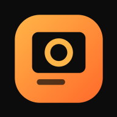
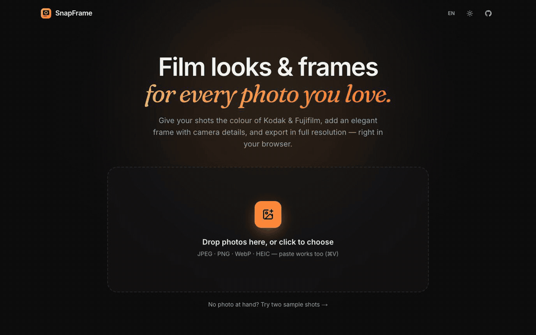

<div align="center">



# SnapFrame

**Film looks & beautiful frames for your photos — right in your browser.**
Kodak & Fujifilm-inspired colour, EXIF captions, batch export. Your photos never leave your device.

**[snap-frame.tungdadev.com](https://snap-frame.tungdadev.com)**



</div>

## ✨ Features

| | |
|---|---|
| 🎞️ **62 film looks** | **Kodak** Portra 160/400/800, Ektar, Gold, ColorPlus, UltraMax, Ektachrome, Kodachrome, Aerochrome · **Fujifilm** Classic Chrome, Classic Neg., Nostalgic Neg., Velvia, Provia, Astia, Pro 400H, Superia, C200, Eterna, Reala Ace · **B&W** Tri-X, HP5, Acros, T-Max, Delta 3200, red filter, high key, noir, sepia, selenium, cyanotype · **Cinema** CineStill 800T/50D, teal & orange, bleach bypass, neon night… · **Instant & vintage** Polaroid 600, SX-70, Instax, Lomo, cross process, 1970s, 1980s, camcorder… · **Creative** golden hour, pastel, matte, nordic, forest, ocean, autumn, Saigon street, Kyoto, duotone, pop. Live previews on *your* photo, with a strength slider. |
| 🎚️ **Pro adjustments** | Exposure, contrast, highlights, shadows, temperature, tint, saturation, vibrance, fade, grain, vignette, halation, sharpen — stacked on top of the look. |
| 🖼️ **34 frames** | **Classic** white, noir, minimal, rangefinder, chroma, cream, kraft · **Gallery** gallery, editorial, floating, museum, wood frame, gilded, blur backdrop · **Film** Polaroid, Instax, film strip, 120 film, slide mount, darkroom, cinema, date stamp · **Colour** blush, sage, sky, mocha, sunset, aurora · **Fun** postage stamp, deckle edge, scrapbook tape, air mail, neon — or none. Every frame previewed live on your photo. Any aspect ratio (1:1, 4:5, 9:16, 3:2, 16:9), margin, rounded corners, shadow, border, background colour. |
| 📷 **EXIF captions** | Camera, lens, focal length, aperture, shutter, ISO and date read from the photo; edit any field, choose what to print, 4 fonts, 3 layouts. GPS is never read. |
| ✍️ **Signature** | Text (script, sans, serif, mono) or your own logo, 9 positions, size and opacity. |
| 📚 **Batch** | Open many photos at once, *Apply to all*, export everything as a ZIP. Save your own presets. |
| 📱 **Made for phones** | One-thumb editing: swipe through looks and frames under a big preview, press and hold the photo to compare, swipe to switch photos, share straight to Instagram/Zalo/Messenger. Add it to your home screen to use it like an app. |
| ⚡ **Fast** | One WebGL2 shader grades the whole photo on the GPU; full-resolution export in well under a second. |
| 🔒 **Private & offline** | 100% client-side static site: no server, no upload, no account, no tracking. Installable PWA that works offline. |
| 🌏 **English & Tiếng Việt** | Dark and light themes, mobile-friendly. |

Also: before/after split view (and hold <kbd>\\</kbd> to peek at the original), undo/redo (<kbd>⌘Z</kbd> / <kbd>⇧⌘Z</kbd>),
drag-and-drop or paste (<kbd>⌘V</kbd>) photos, HEIC support, JPEG/PNG/WebP export, native share sheet on phones.

## 🚀 Use it

1. Open **https://snap-frame.tungdadev.com** (or install it: browser menu → *Install app* / *Add to Home Screen*).
2. Drop photos in — or click *Try two sample shots*.
3. **Film** → pick a look, set its strength. **Adjust** → fine-tune.
4. **Frame** → choose a style and aspect ratio. **Info** → tick the details to print. **Sign** → add your name or logo.
5. **Export** → JPEG/PNG/WebP at full size (or 4096/2048/1080), one photo or all as a ZIP. On a phone, *Share* sends it straight to Instagram, Zalo, Messenger…

## 🛠️ Run locally

Requires Node.js 20+.

```bash
git clone https://github.com/bthanhtung/snap-frame.git
cd snap-frame
npm install
npm run dev          # http://localhost:3000
npm test             # unit tests
npm run build        # static site in ./out — host it anywhere (Vercel, Netlify, GitHub Pages, S3, nginx)
```

## 🧱 How it works

```
src/lib/looks.ts   film looks = parameter sets; strength interpolates neutral → look, adjustments stack on top
src/lib/gl.ts      WebGL2 fragment shader: exposure, white balance, halation, tone, contrast, per-channel
                   lift/gain, split toning, saturation/vibrance, B&W mixer, fade, vignette, resolution-independent grain
src/lib/frame.ts   Canvas 2D frame composition; sized relative to the photo, so preview = export
src/lib/image.ts   decoding (incl. HEIC), high-quality downscaling, EXIF → captions
src/lib/render.ts  full-resolution export from the original file, ZIP, share
```

The preview works on a 1800 px copy; exports re-decode the original file. Next.js builds a static export
(`output: 'export'`) — there are no API routes.

## 📸 Credits

Sample photos are CC0 — see [`public/samples/CREDITS.md`](public/samples/CREDITS.md).
Film looks are interpretations inspired by classic film stocks; SnapFrame is not affiliated with Kodak, Fujifilm, Ilford, CineStill, Polaroid or Agfa.

## 📄 License

[MIT](LICENSE)
